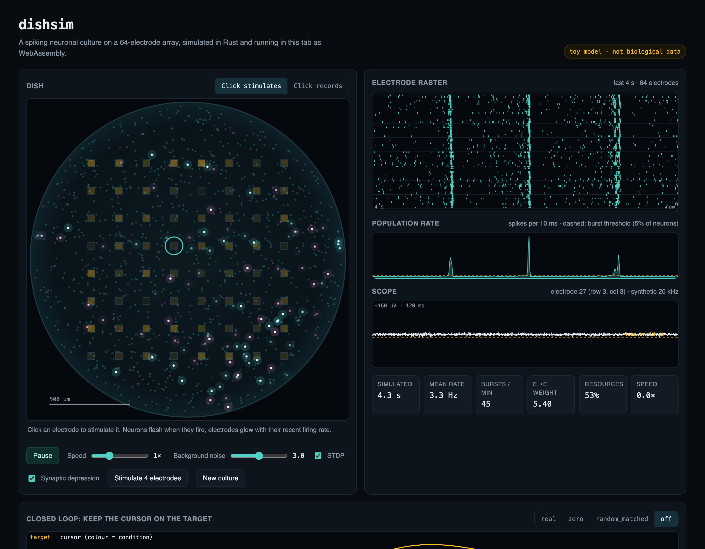

# dishsim

[](https://github.com/Arihanth-Mutha/dishsim/actions/workflows/ci.yml)
[](https://arihanth-mutha.github.io/dishsim/)


**A spiking neuronal culture on a 64-electrode array that runs in a browser tab.**

**[Open the live demo →](https://arihanth-mutha.github.io/dishsim/)**



1,024 spiking neurons on a simulated dish, wired by distance, with conduction delays,
short-term synaptic depression and spike-timing-dependent plasticity, under an 8×8
electrode grid you can record from and stimulate. The simulation is Rust compiled to a
56 KB WebAssembly module with no dependencies and no wasm-bindgen. The page reads
spikes, voltages and electrode counts straight out of WebAssembly memory every frame.

## Things to try

- **Watch it burst.** Left alone, the network fires in synchronised network bursts about
  once a second, the signature pattern of cultured cortical networks. They show as
  vertical bands in the raster and spikes in the population rate.
- **Poke it.** Click an electrode to stimulate it. Nearby neurons fire within a few
  milliseconds, and sometimes the whole network follows.
- **Break it.** Untick *synaptic depression* and the bursts stop ending on time. Turn the
  background noise up or down and the culture goes from silent to seizing.
- **Close the loop.** The tracking task stimulates the side of the array where a target
  is, and decodes a cursor from the left/right spike balance. Compare `real` against the
  `zero` and `random_matched` controls.
- **Run the experiment.** One click runs 27 blocks in Latin-square order and exports a
  CSV that [beatnull](https://github.com/Arihanth-Mutha/beatnull) analyses directly.

## From simulated culture to a statistical verdict

The same experiment runs headless from the command line:

```console
$ cd web && npm run experiment -- 1 > run.csv
seed 1: 1080 trials, 66.5 s simulated in 1.29 s
  real             93.6% hit rate (sd 3.6%, 9 blocks)
  zero             13.3% hit rate (sd 11.9%, 9 blocks)
  random_matched   38.3% hit rate (sd 32.5%, 9 blocks)

$ beatnull check run.csv --metric hit --group suite      # output abridged
■ BEATS CONTROLS — real beats all 2 control(s) at alpha = 0.05.
  pass         Data integrity         No missing trials.
  pass         Real vs controls       real beats all 2 control(s) at alpha = 0.05.
  pass         Order effects          No detectable drift (rho = -0.21, p = 0.287); schedule balanced.
  info         Improvement over time  No detectable increase across the run in real (rho = +0.06, p = 0.465).
    real vs zero             diff +0.8028 [+0.7222, +0.8722]  p_holm 0.0002
    real vs random_matched   diff +0.5528 [+0.3556, +0.7556]  p_holm 0.0002
```

The honest reading, which the page also states: real beats its controls because a
stimulus excites the side of the array it lands on. This is a reflex arc, not
learning, and beatnull finds no improvement over time to suggest otherwise. Seeds 2
and 3 give real 89.2% and 90.8% against controls between 13% and 33%.

## Numbers

| | |
|---|---|
| neurons / synapses | 1,024 (80% excitatory) / 81,920 |
| simulation speed | 87× real time natively; ~50× in WebAssembly, including the task logic |
| mean firing rate | 4.0 Hz |
| network bursts | 1.25 per second; 77% of spikes fall inside bursts |
| stimulus response | the stimulated electrode records a spike within 10 ms on 96% of stimuli, vs 5% without |
| module size | 56 KB `.wasm`, 19 KB JS, no runtime dependencies |

Measured with `cargo run --release --example stats 60` on an Apple M4 Pro.

## The model

| Piece | What it does | Reference |
|---|---|---|
| Izhikevich neurons | Regular-spiking excitatory cells (shading into chattering) and fast-spiking inhibitory cells; two 0.5 ms half-steps per 1 ms tick | Izhikevich, *IEEE TNN* 2003 |
| Distance-dependent wiring | 80 outgoing synapses per neuron, probability `exp(-d / 0.24 mm)`; delays of 1–8 ms by distance | |
| Short-term depression | Each spike uses 25% of the neuron's synaptic resources, which recover with τ = 1.5 s. Depletion helps end bursts and spaces them out | Tsodyks & Markram, *PNAS* 1997 |
| STDP | Pair-based, exponential traces (τ = 20 ms) on excitatory-to-excitatory synapses, weights bounded in [0, 10] | Song, Miller & Abbott, *Nat Neurosci* 2000 |
| Electrodes | 8×8 grid, ~170 µm pitch. Each records neurons within ~64 µm and stimulates neurons within ~150 µm, falling off linearly | |
| Scope | Synthetic 20 kHz extracellular voltage on one electrode: a biphasic waveform per recorded spike, scaled by distance, plus noise and a stimulation artifact | |

Network bursts in dissociated cortical cultures on MEAs are well documented (for
example Wagenaar, Pine & Potter, *BMC Neuroscience* 2006). The parameters here were
tuned by eye and by `examples/stats.rs` to reproduce that pattern qualitatively.
**They are not fitted to any culture, organoid or device**, and nothing dishsim shows
is evidence about biological neurons.

## Architecture

```
core/ (Rust, no dependencies)                 web/ (TypeScript, Canvas 2D, Vite)
┌──────────────────────────────┐             ┌──────────────────────────────────────┐
│ Sim: neurons, synapses (CSR),│  extern "C" │ Dish: typed views over wasm memory   │
│ delay ring buffer, traces,   │ ──────────▶ │ Tracker + Experiment: closed loop,   │
│ electrodes, scope synthesis  │  pointers   │   Latin squares, CSV for beatnull   │
│ dish_init/step/stimulate/... │             │ views: dish, raster, rate, scope     │
└──────────────────────────────┘             └──────────────────────────────────────┘
```

- Synapses are stored as compressed sparse rows by presynaptic neuron, with a reverse
  index for potentiation. Spikes are delivered into a delay ring buffer, so a step costs
  O(neurons + spikes × fan-out).
- The interface is nine `extern "C"` functions over one simulation. `dish_ptr` /
  `dish_len` hand out addresses of internal buffers, and the page wraps them in typed
  arrays, rebuilt every access because WebAssembly memory can grow.
- `scripts/experiment.ts` runs the identical task code headless under Node, which is
  how the experiment above was produced and how CI checks it.

## Run it locally

```bash
rustup target add wasm32-unknown-unknown
cd web
npm install
npm run dev          # builds the wasm module, serves on localhost
npm run build        # static site in web/dist
npm run experiment -- 3 > run.csv
cd ../core && cargo test --release && cargo run --release --example stats
```

## Tests

- **Rust: 10 tests.** Determinism per seed, local wiring, electrode coverage,
  stimulation evoking local (not global) activity in 5 ms, scope sample counts,
  recurring network bursts holding most spikes, depression restraining recurrent
  excitation, STDP changing weights only when enabled and within bounds, reliable
  stimulus responses above baseline, and the WebAssembly interface round trip.
- **CI** runs fmt, clippy, the tests, a production build and a headless experiment.
  GitHub Pages deploys `web/dist` on every push to `main`.

## Prior art

Spiking-network simulators, culture models and browser neuroscience tools all exist.
dishsim combines ideas from them into a small interactive demo. It is not a research
simulator.

| Work | What it is | How dishsim differs |
|---|---|---|
| [Brian2](https://briansimulator.org) and [Brian2Wasm](https://neurostars.org/t/gsoc-2025-project-7-brian-simulator-brian2wasm-simulations-in-the-browser-175-350h/32065) | General spiking simulator; an ongoing GSoC project compiles its generated code to WebAssembly so models run in a browser | Brian is general-purpose and far more capable. dishsim is one fixed model with an electrode array and a closed-loop task built in |
| [NEST](https://www.nest-simulator.org) / [NEST Desktop](https://pypi.org/project/nest-desktop) | Large-scale simulator with a graphical web front end backed by a server | Research scale, needs a server |
| [Neuronify](https://doi.org/10.1523/ENEURO.0022-17.2017) (Dragly et al., 2017) | Educational drag-and-drop circuit simulator for desktop and mobile | Small integrate-and-fire circuits; no array or culture |
| [Sim-MEA](https://content.iospress.com/articles/fundamenta-informaticae/fi124-1-2-07) (*Fundamenta Informaticae*, 2013) | Izhikevich-based culture simulator that models neuron-to-electrode distances, compared against hippocampal cultures | The closest model. A research tool rather than an interactive one; I could not find public code |
| [Stiber et al., 2026](https://arxiv.org/abs/2602.22364) | Simulated cortical cultures that reproduce spatiotemporal bursting | Research-grade burst modelling |
| Cortical Labs' [cl-sdk simulator](https://docs.corticallabs.com/cl/sim) | Replays recordings or generates random frames for CL1 app development, and accepts custom data sources | A stand-in for the device API, not a network model |
| [MEArec](https://doi.org/10.1007/s12021-020-09467-7) (Buccino & Einevoll) | Realistic ground-truth extracellular recordings | dishsim's scope trace is a cartoon by comparison |

What I did not find is an in-browser culture-on-an-array simulator with a closed-loop
task and a counterbalanced experiment export. If one exists, please open an issue.

## Context

I built dishsim alongside wetloop, a
development platform for living-neuron computers, as a way to *see* the workflow
wetloop is built for: stimulate, record, decode, compare against controls, and refuse
to call a reflex "learning". Its siblings are
[spikeloop](https://github.com/Arihanth-Mutha/spikeloop) (real-time spike detection)
and [beatnull](https://github.com/Arihanth-Mutha/beatnull) (does the result beat its
controls?).

## License

Apache-2.0
